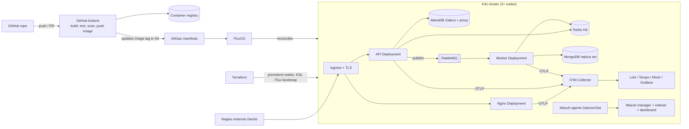

# Platform Migration Plan: Kubernetes, Queues, IaC, CI/CD, Observability, Security

This plan complements [ToDo.md](./ToDo.md). It describes how to move the
Compose-based stack (see [README.md](./README.md)) to Kubernetes with the
technologies below. Docker Compose stays as the local development environment.

## Technology decisions

| Area | Choice | Rationale |
|------|--------|-----------|
| Cluster | **K3s** (3 nodes; Minikube only for single-developer smoke tests) | Multi-node, lightweight, real HA semantics (embedded etcd) |
| IaC | **Terraform** (with OpenTofu compatibility) | Mature providers for K3s hosts, Helm, Kubernetes, and cloud/VM resources |
| GitOps | **FluxCD** | Pull-based reconciliation of cluster state from Git |
| CI/CD | **GitHub Actions** | Repository is already on GitHub; no extra server to run |
| Queues | **RabbitMQ** (Cluster Operator) | Durable queues, retries, dead-lettering; NATS JetStream is the alternative |
| Observability | **OpenTelemetry + Grafana LGTM** (Loki, Grafana, Tempo, Mimir) | Unified logs, metrics, traces; Nagios kept for external black-box checks |
| Security | **Wazuh** (+ Kubernetes-native controls) | Host/container IDS, FIM, vulnerability detection, compliance |

## Target architecture



## Queue use cases

1. **Asynchronous review writes**: `POST` review → API validates and publishes to
   `reviews.created`; a worker persists to MongoDB. Add idempotency keys,
   retries with backoff, and a dead-letter queue (`reviews.dlq`).
2. **Cache invalidation**: catalog changes publish `catalog.changed`; workers
   (or API pods via fan-out exchange) delete scoped Redis keys.
3. **Cache warm-up / stampede protection**: a single worker consumes
   `catalog.refresh` and repopulates the cache, so cache misses do not all hit
   MariaDB (addresses ToDo item 4).

## Phases

### Phase 0 – Prerequisites
- [ ] Containerize with versioned, non-root, minimal images for `web` and
  `application`; add `/healthz` and `/readyz` endpoints to the API.
- [ ] Make the API configuration 12-factor (env vars only, no hardcoded hosts).
- [ ] Decide registry (GHCR) and image tagging (`sha-<commit>` + semver).

### Phase 1 – IaC with Terraform
- [ ] Create `infra/terraform/` with modules: `network`, `k3s-nodes`,
  `flux-bootstrap`, `storage`.
- [ ] Provision 3 server nodes (VMs or local multipass/libvirt) and install K3s
  with embedded etcd HA.
- [ ] Remote state with locking; separate workspaces/tfvars for `dev` and
  `prod`.
- [ ] Bootstrap FluxCD via the Terraform `flux` provider.
- [ ] Run `terraform fmt`, `validate`, `tflint`, and `checkov` in CI.
- Local alternative: `minikube start --nodes 3` for developer testing.

### Phase 2 – Kubernetes workloads
- [ ] Add `deploy/` (Kustomize base + `dev`/`prod` overlays) or Helm charts for:
  web, API, worker, ConfigMaps, Services, Ingress.
- [ ] Replace HAProxy + Keepalived with Service/Ingress (Traefik ships with K3s)
  and MetalLB for a VIP on bare metal.
- [ ] Set resource requests/limits, liveness/readiness probes, HPAs,
  PodDisruptionBudgets, and topology spread constraints.
- [ ] Deploy data tier via operators: MariaDB Operator (Galera) with
  MaxScale/ProxySQL, MongoDB Community Operator (replica set), Redis
  Sentinel/operator, RabbitMQ Cluster Operator.
- [ ] Add NetworkPolicies (default-deny, explicit allows per tier).

### Phase 3 – Queues
- [ ] Deploy RabbitMQ (3 replicas, quorum queues, persistent volumes).
- [ ] Add a `worker/` service; add publisher code to
  [index.js](./application/index.js).
- [ ] Define exchanges, queues, DLQs, and message schemas in version control.
- [ ] Add queue depth, consumer lag, and DLQ alerts.
- [ ] Autoscale workers on queue depth (KEDA, optional).

### Phase 4 – CI/CD with GitHub Actions
- [ ] `ci.yml` on PRs: lint, unit tests, build images, Trivy image scan,
  `terraform validate`, `kubeconform` on manifests.
- [ ] `release.yml` on `main`: build and push images to GHCR, sign with cosign,
  generate SBOM, then commit the new image tag to the GitOps path (or let Flux
  image automation do it).
- [ ] Use OIDC to cloud/registry; no long-lived credentials in repo secrets
  where avoidable.
- [ ] `terraform plan` comment on PRs; `apply` only from protected `main` with
  manual approval.
- [ ] Optional Jenkins alternative is out of scope unless a self-hosted
  requirement appears.

### Phase 5 – GitOps with FluxCD
Use cases to implement:
- [ ] **Cluster bootstrap**: `clusters/<env>/` holds Flux `GitRepository` and
  `Kustomization` objects; Terraform only bootstraps Flux itself.
- [ ] **Environment promotion**: `dev` tracks `main`; `prod` tracks tags or a
  `release` branch, with PR approval as the promotion gate.
- [ ] **Image automation**: `ImageRepository`, `ImagePolicy`,
  `ImageUpdateAutomation` to update tags in Git.
- [ ] **Dependency ordering**: `dependsOn` chain — operators → data tier →
  queues → apps → observability configs.
- [ ] **Drift correction & rollback**: manual `kubectl` changes are reverted;
  rollback is `git revert`.
- [ ] **Secrets**: SOPS (age) or External Secrets with Flux decryption.
- [ ] **Notifications**: Flux `Provider`/`Alert` to Slack/GitHub commit status.

### Phase 6 – Observability (OpenTelemetry + LGTM)
- [ ] Deploy `grafana/lgtm`-style stack via Helm (Loki, Tempo, Mimir, Grafana)
  managed by Flux; Alloy or the OTel Collector as the gateway.
- [ ] Instrument with OpenTelemetry:
  - Node.js API: `@opentelemetry/sdk-node` auto-instrumentation (HTTP, Redis,
    MySQL, MongoDB, AMQP) with context propagation through RabbitMQ message
    headers.
  - Nginx: `ngx_otel_module` to start/continue `traceparent`.
  - Browser: `@opentelemetry/sdk-trace-web`, replacing the custom trace headers
    and UI in [catalog.js](./web/catalog.js).
- [ ] OTel Collector as DaemonSet (agent) + Deployment (gateway): OTLP in;
  traces → Tempo, metrics → Mimir, logs → Loki. Add `k8sattributes` processor.
- [ ] Dashboards: RED metrics per service, cache hit rate, Galera cluster
  health, RabbitMQ depth, node/pod saturation. Alerts via Grafana/Alertmanager.
- [ ] Define SLOs (e.g. p95 latency, availability) and burn-rate alerts.
- [ ] Nagios: keep as an **external** black-box monitor (HTTP, TLS expiry,
  Kubernetes API reachability) outside the cluster, porting checks from
  [architecture.cfg](./nagios/architecture.cfg). Avoid duplicating in-cluster
  metrics alerting.

### Phase 7 – Security
- [ ] Deploy Wazuh (manager, indexer, dashboard) via Helm/manifests in a
  dedicated namespace; Wazuh agents as a DaemonSet on every node.
- [ ] Enable FIM, vulnerability detection, rootcheck, Kubernetes/container and
  audit-log ingestion; forward K3s audit logs to Wazuh.
- [ ] Integrate Wazuh alerts with Grafana/Slack; tune rules and active
  response conservatively.
- [ ] Cluster hardening: Pod Security Admission `restricted`, non-root
  containers, read-only root FS, RBAC least privilege, CIS benchmark via
  kube-bench.
- [ ] TLS via cert-manager at ingress; mTLS between services (optional mesh).
- [ ] Least-privilege MongoDB/Redis/MariaDB users; secrets in SOPS/External
  Secrets (resolves ToDo item 6).
- [ ] API authentication and rate limiting at the ingress.
- [ ] Supply chain: Trivy in CI, cosign signature verification (Kyverno
  policy), Dependabot.

### Phase 8 – Cutover and validation
- [ ] Run Compose and K3s in parallel; shift traffic gradually via DNS weights.
- [ ] Port the [resilience-lab](./resilience-lab/README.md) scenarios to
  Kubernetes (pod/node kill via Chaos Mesh or Litmus) and verify SLOs.
- [ ] Test backup/restore for MariaDB, MongoDB, and RabbitMQ definitions.
- [ ] Write runbooks: deploy, rollback, node loss, queue backlog, security
  incident.
- [ ] Decommission HAProxy/Keepalived containers from the production path.

## Proposed repository layout

```text
infra/terraform/{modules,envs/dev,envs/prod}
clusters/{dev,prod}/            # Flux entrypoints
deploy/{base,overlays/dev,overlays/prod}
deploy/platform/{operators,rabbitmq,observability,wazuh,cert-manager}
worker/                          # queue consumer
.github/workflows/{ci.yml,release.yml,terraform.yml}
```

## Suggested order

1. Phase 0 and 1 (images, Terraform, K3s).
2. Phase 5 bootstrap (Flux) so everything after is deployed via Git.
3. Phase 2 (stateless apps, then data operators).
4. Phase 4 (CI/CD) alongside Phase 2.
5. Phase 6 (OTel + LGTM) before introducing queues, so queue work is traceable.
6. Phase 3 (RabbitMQ + worker).
7. Phase 7 (Wazuh and hardening), then Phase 8 cutover.
